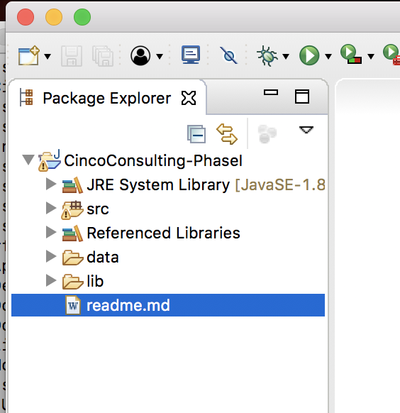
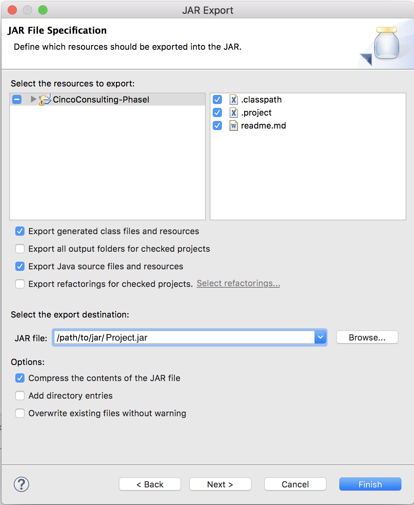

# Computer Science II
## Project Overview
### Spring 2027
---

> If you don't have the time to do it right, then you'll have to find
> the time to do it over.

# Introduction

Over the course of this semester, you will incrementally build a
substantial database-backed application in Java. In each phase of the
project you will focus on a particular component, which will have
*deliverables* that you must hand in by a certain date. These
deliverables may include a Java Archive (JAR) file, source code,
non-trivial test cases, database schemas and a well-written technical
design document.

Each phase builds upon prior phases and may also require updates and
modifications to prior phases. It is important that you understand the
entire scope of the project. You should read all of the assignments to
get a better understanding of where the project will be going.

The iterative nature of this project means that it is *vital* that you
do not fall behind. In each phase it is also important that you have a
good, well-thought design to make subsequent phases easier to design,
extend and implement. Poor designs, bad implementations, bugs and broken
code will mean subsequent phases of this project will suffer. Investing
your time and resources upfront will minimize your *technical debt* and
mitigate the need to update or refactor your design later on. Remember
one of the Golden Rules of coding: only code that which you would not
mind having to maintain.

# Problem Statement

## Background

Local investor Rae Sloane has just acquired a chain of regional video game
stores, Bit Geeks (BG Inc.). Unfortunately, the previous owner did not have
a good technology infrastructure. All sales records are maintained by a
collection of Excel sheets and obscure macros that produce sales reports.

In an effort to update business practices and to compete in the looming
digital-copy-only market, Sloane wants to modernize BG Inc. by designing
and implementing new systems for payroll, inventory, marketing, and
sales.  Each system will be independently developed.  **Your** team
is responsible for developing the sales subsystem that will be responsible
for keeping track of all sales in a database-backed system.  The system
will also be responsible for producing several different reports.

It will be your responsibility to design a new system from scratch that
is object oriented, written in Java, and supports BG Inc.'s business model
by implementing their business rules and providing the functionality as
detailed below.

## Sale Items

BG Inc.'s stores sell new and used video games and systems, as well as
accessories, gift cards, subscriptions, and related products.

Each item is uniquely identified with with a Universally Unique ID (UUID)
and has name.   All items fall under three main categories. and e

-  **Products**  Products include games (physical and digital copies), game
   systems, toys, apparel, etc., as well as gift cards.  Each product has
   a specific *retail price*.  However, depending on the subcategory of the
   product, this price may be modified:

    - All new items' cost is the retail price.
    - All used items' cost is 80% of the retail price.
    - Gift card prices are determined by how much a customer specifies
      for a particular sale.

- **Services**  BG Inc. offers several services that are performed by
  trained staff and may include repair, cleaning, in-home system setup,
  PC system builds, game training, etc.  Each service is associated with a
  particular employee and is billed on a per-hour basis.

  When a purchase is made, a fixed number of hours is charged to the
  customer. Thus, the total cost of a service is the hourly rate multiplied
  by the number of hours.

- **Subscriptions**  Subscriptions include online game service subscriptions,
  memberships, online game licenses, or third-party services.  Subscriptions
  are billed based on an annual fee.

  When purchased, subscriptions have an effective begin and effective end date
  to determine billing.  The total cost of a subscription is the number of
  days included in the effective dates divided by 365, multiplied by the annual
  fee.

## Sales

A *sale* is a collection of items purchased by a customer at a particular store.

Each sale includes:

- A UUID code identifying the sale.
- The customer (and their information) that the sale has been made to.
- The store (and its information) where the sale was made.
- A number of items included in that particular sale.

## Fees and Taxes

Depending on the customer and the items on the sale, various fees and taxes are also applied.

- All products have a 6.42% sales tax.
- All services have a 4.20% service sales tax.
- No tax is applied to subscriptions.

## Other Business Rules

- Taxes are applied to each sale item independently (since they may have
  different rates).
- For all dollar values, the system will need to round to the
  nearest cent.
  
# Project Outline

Over the course of this semester you will iteratively design an
application to support this business model. Development has been broken
down into 6 phases:

-   Phase I: Data Representation & Electronic Data Interchange (EDI) --
    in the first phase you will design and implement the objects that
    will form a basis for the system and create parsers to read data
    from flat files, generate instances of your objects and export them
    to an interchange format (XML and/or JSON).

-   Phase II: Hierarchy Design & Implementation -- In this phase you will
    further refine your objects and define relationships between them.  You
    will test your implementation by developing a small JUnit testing suite.

-   Phase III: Summary Reports -- You will write additional parsing code
    to read full invoice data from flat files and produce several reports.

-   Phase IV: Database Design -- This phase focuses on designing a
    relational database to model your objects and support your
    application

-   Phase V: Database Connectivity -- You will refactor your code to
    load your objects to your database rather than from flat files

-   Phase VI: Database Persistence -- You will implement and use an API
    to persist (save) data to your database.

-   Phase VII: Sorted List ADT -- In this phase you design and implement
    a sorted list ADT and integrate it into your application

# Project Setup Requirements

To ensure that your projects will run on the webgrader you *must* adhere
to the following requirements and procedures. Failure to do so may make
it impossible to grade your project and you will not receive credit.

A full video walkthrough of the project setup and export process has been
provided here:

https://www.youtube.com/watch?v=lfGVthy2A14&list=PL4IH6CVPpTZXOMCZRaFy_WRc-GvANOZfk&index=4

It is possible to make a compatible setup using other IDEs.
We have (old) instructions for IntelliJ available upon request, but not for
other IDEs.  If you develop a compatible process, please share it so we
can provide it to other students.

## Setup Requirements (Eclipse)

-   You *must* include a `readme.md` (a markdown file) file at the root of
    your project with your name(s), NUIDs and preferred email. If you choose
    to work in pairs, **both** names/contact info should be included.

-   All data files *must* be included in a directory named `data`
    at the root of your project.

-   Any external JAR libraries should be placed in a directory named
    `lib` at the root of your project. Your project should look
    something like the following.

    

    To add external JAR files to your project do the following.

    1.  Drag and drop your JAR file to this folder, be sure to select
        "copy files"

    2.  Right click the new JAR file in your `lib` folder and
        select `Build Path` then `Add to Build Path`

-   Your `main` method *must* be in the package and class name
    specified by **each** assignment.

## Exporting Your Project (Eclipse)

To export your project for submission to webgrader, do the following:

1.  Run your program at least once, this creates a "Launch
    Configuration" in Eclipse

2.  Right click your project and select `Export...`

3.  Under the Java folder, select `JAR file`, click `Next`

4.  Be sure to check `Export Java source files and resources` and
    select the location where you want the JAR file saved. It should
    look something like the following.

    ::: center
    
    :::

5.  You can now click `Finish` and it should save the project as
    a JAR file which you will then turn in. The JAR file should contain
    all libraries, classes, source files and other data files necessary,
    but you should be sure it works by running the webgrader and
    addressing any issues.

# Partner Policy & Procedure

You may choose to work alone or with a single partner (i.e. *pairs*) for
each phase of the project. You may change partners between each phase if
you choose. If you do choose to work in pairs, **you must adhere** to the
following guidelines.

-   All work must be the result of an equal collaborative effort by each
    partner. You may not simply partition the work between you.

-   In order to work in pairs, you *must* join a group together in
    Canvas under "People" and then "Project Partners" group set. **Do not** create
    your own group set, use an existing one.

-   Turn in only one copy of the design document with both of your names
    on it.

-   Both of you *should* turn in an electronic copy of all artifacts using
    the webhandin, but ***we will grade based on the submission of the
    partner whose last name comes first alphabetically.***

-   You are *highly encouraged* to use some sort of revision control
    system such as git. However, you must ensure that your team's
    codebase and artifacts are not publicly accessible. Failure to do so
    will be considered a violation of the department's academic
    integrity policy.
